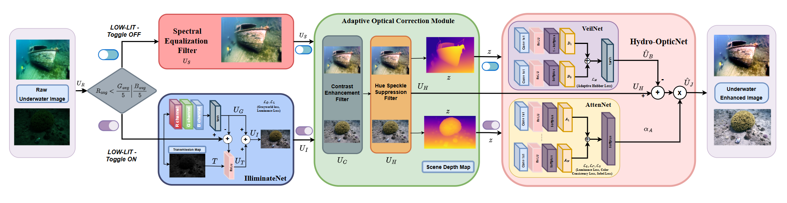

# DIVER

[](LICENSE)
[](https://pytorch.org/)
[](https://www.python.org/)

# DIVER: Domain-Invariant Visual Enhancement and Restoration

Underwater images degrade because of wavelength-dependent attenuation, scattering, and non-uniform illumination.

DIVER is an unsupervised underwater image enhancement framework. It combines empirical correction with physics-guided modeling. The code in this repository implements the four stages used in the paper:

1. **IlluminateNet** for low-lit images, or the **Spectral Equalization Filter (SEF)** for adequately lit images.
2. **Adaptive Optical Correction Module (AOCM)** for contrast, gamma correction of the weaker channels, hue-speckle suppression, and unsharp masking.
3. A scene-depth map from **Depth Anything V2 Small**.
4. **Hydro-OpticNet (VeilNet and AttenNet)** for backscatter and wavelength-dependent attenuation.

The paper evaluates DIVER on nine datasets: SeaThru, OceanDark, USOD10K, FISHTRAC, U45, UIEB, UFO-120, LSUI, and EUVP. 
<div align="center">
  
</div>

## Repository layout

Run the code from the inner `DIVER/` directory. Imports and the notebook paths are relative to that directory.

```text
DIVER/                                            repository root
├── LICENSE
├── README.md
├── DIVER_BlockDaigram.png
├── Processing Workflow - Training and Inference.docx
└── DIVER/
    ├── training+inference.ipynb                  main entry point
    ├── req.txt                                   Python dependencies
    ├── illuminatenet_main.py                     IlluminateNet optimization
    ├── illuminatenet_inf.py                      IlluminateNet inference
    ├── aocm_algorithm.py                         SEF and AOCM
    ├── depth_generation.py                       Depth Anything V2 Small
    ├── hydroopticnet_main.py                     Hydro-OpticNet optimization
    ├── hydroopticnet_inf.py                      Hydro-OpticNet inference
    ├── scores.py                                 UIQM, UCIQE, and related scores
    ├── IlluminateNet_Weights/
    │   ├── SeeThru/model_checkpoint.pth
    │   └── FishTrac/model_checkpoint_18.pth
    └── Diver_checkpoints/
        ├── Diver_ST_Final/model_checkpoint_4.pth
        ├── Diver_OD_Final/model_checkpoint_13.pth
        ├── Diver_USOD_Final/model_checkpoint_92.pth
        ├── Diver_FishTrac_Final/model_checkpoint_14.pth
        ├── Diver_U45_Final/model_checkpoint_4.pth
        ├── Diver_UIEB_Final/model_checkpoint_12.pth
        ├── Diver_UFO_Final/model_checkpoint_6.pth
        ├── Diver_LSUI_Final/model_checkpoint_35.pth
        └── Diver_EUVP_Final/model_checkpoint_49.pth
```

`IlluminateNet_Weights/` contains pretrained IlluminateNet weights for SeaThru and FISHTRAC only. The other seven datasets use the SEF branch. `Diver_checkpoints/` contains one Hydro-OpticNet checkpoint folder for each of the nine datasets.

## Setup

```bash
git clone https://github.com/AIRLabIISc/DIVER.git
cd DIVER
python3.12 -m venv .venv
source .venv/bin/activate
python -m pip install --upgrade pip
python -m pip install -r DIVER/req.txt
cd DIVER
```

Python 3.12 is the tested version. A CUDA GPU is recommended. `req.txt` pins `torch==2.9.1`. If that wheel does not match your CUDA driver, install a matching PyTorch build first, then install the remaining packages in `req.txt`.

`depth_generation.py` downloads `depth-anything/Depth-Anything-V2-Small-hf` from Hugging Face on first use.

## How to run

Open `training+inference.ipynb` from the inner `DIVER/` directory, in Jupyter or VS Code. The notebook cells call `python3` and import modules from the working directory, so that directory must be `DIVER/`.

The notebook does not switch branches automatically. Choose one first stage, then run AOCM, depth, and Hydro-OpticNet.

1. **Low-lit branch.** Put the input images in a folder, called `RAW` in the notebook. Build the depth maps used by IlluminateNet, then optimize or run inference:

   ```bash
   python3 illuminatenet_main.py \
     --images RAW \
     --depth Transmap \
     --output IlluminateNet_output \
     --checkpoints IlluminateNet_output/check \
     --batch_size 8 \
     --init_iters 500 \
     --iters 150 \
     --init_lr 0.001
   ```

   Inference reads a checkpoint **folder**. It loads the last file in a sorted listing of that folder. Each released folder contains one checkpoint, so pass the folder rather than the `.pth` path:

   ```bash
   python3 illuminatenet_inf.py \
     --images RAW \
     --depth Transmap \
     --output IlluminateNet_inf \
     --checkpoints IlluminateNet_Weights/SeeThru
   ```

   Use `IlluminateNet_Weights/FishTrac` for FISHTRAC.

2. **Adequately lit branch.** The notebook calls `spectral_equalization_filter` and writes `SEF_output/`.

3. **AOCM.** The notebook calls `AOCM` on `IlluminateNet_output/` or `SEF_output/` and writes `AOCM_output/`.

4. **Depth for Hydro-OpticNet.**

   ```python
   from depth_generation import depth_gen
   depth_gen(input_folder="AOCM_output/", output_folder="depths")
   ```

    Hydro-OpticNet expects a single-channel depth map in `--depth`. Use a grayscale depth PNG in that folder.

5. **Hydro-OpticNet.** The commands below use the settings reported in the paper: batch size 10, 500 iterations, and Adam learning rate 0.001.

   ```bash
   python3 hydroopticnet_main.py \
     --images AOCM_output \
     --depth depths \
     --output Hydroopticnet_output \
     --checkpoints Hydroopticnet_output/check \
     --batch_size 10 \
     --init_iters 500 \
     --iters 500 \
     --init_lr 0.001
   ```

   ```bash
   python3 hydroopticnet_inf.py \
     --images AOCM_output \
     --depth depths \
     --output Hydroopticnet_inf \
     --checkpoints Diver_checkpoints/Diver_ST_Final
   ```

   Replace `Diver_ST_Final` with the folder for the dataset you are running. Inference again loads the last sorted file in the folder you pass to `--checkpoints`.

`--height` and `--width` resize both the image and the depth map. 

## License

This project is released under the MIT License. See [LICENSE](LICENSE).

## Citation

If you use this code, please cite the accompanying manuscript:


```bibtex
@article{makam2026diver,
  title   = {Development of Domain-Invariant Visual Enhancement and Restoration (DIVER) Approach for Underwater Images},
  author  = {Makam, Rajini and Patil, Sharanya and T M, Dhatri Shankari and Sundaram, Suresh and Sundararajan, Narasimhan},
  journal = {arXiv preprint arXiv:2601.22878},
  year    = {2026}
}


